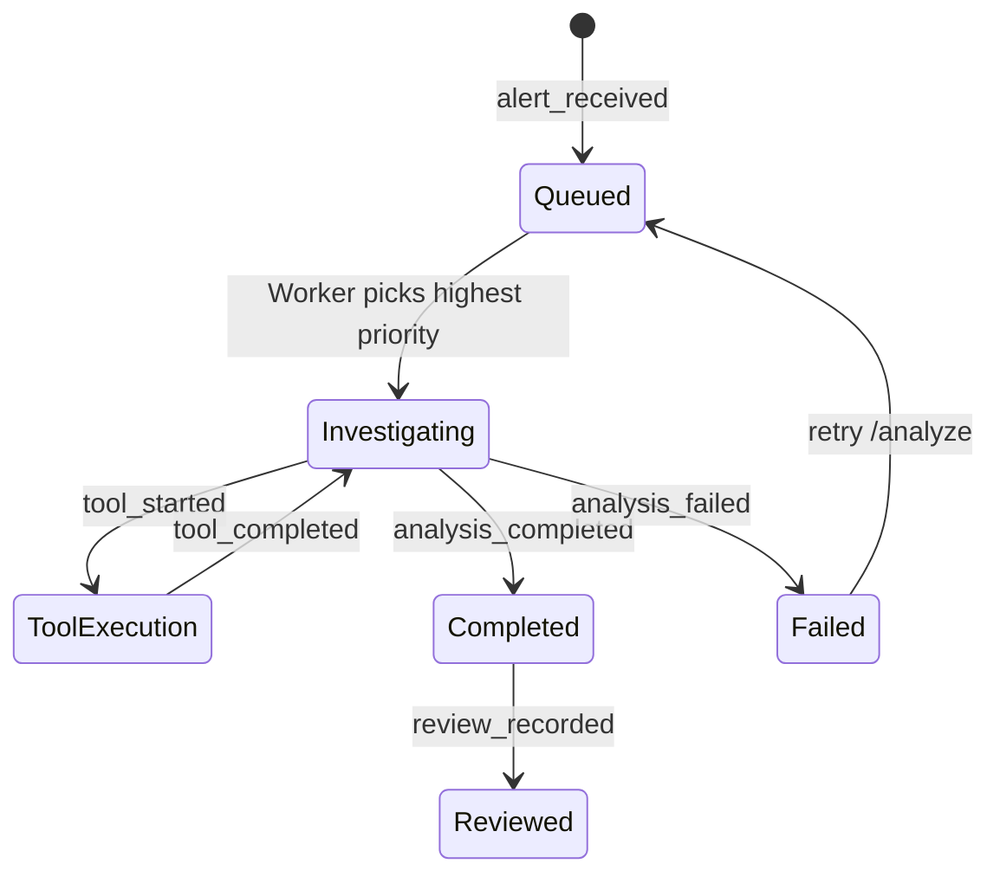

# Anvesaka API Contract & Event Specification

- **Version:** `1.0.0`
- **Owner:** Member 4 (API, Contracts and Integration)
- **Status:** Approved for Implementation (Shared Base)
- **Source Schema Reference:** [`anvesaka_AI/schemas.py`](file:///Users/atulyakulshreshtha/Projects/Anveshaka/anvesaka_AI/schemas.py)

---

## 1. Overview & Architectural Principles

This document defines the interface boundary connecting the backend services, the LangGraph agent, the alert simulator/queue, and the judge-facing frontend console.

### Key Rules & Constraints
1. **Source of Truth:** All field names, types, and enums match [`anvesaka_AI/schemas.py`](file:///Users/atulyakulshreshtha/Projects/Anveshaka/anvesaka_AI/schemas.py). No client or service may invent alternate models.
2. **Communication Pattern:**
   * **REST Endpoints (`/api/...`):** Used for queries, state inspection, human reviewer decisions, and simulator controls.
   * **Server-Sent Events (`GET /events`):** Used for uni-directional realtime push of alert arrivals, queue reordering, live tool execution traces, and triage conclusions.
3. **No Automatic Remediation:** Neither the agent nor the review endpoint executes infrastructure commands. The review endpoint records human oversight for auditing and demonstration only.
4. **Tool Trace Transparency:** Every investigation outcome includes an ordered timeline of executed tools (`tool_trace`), their parameters, execution latency, and summary findings.

---

## 2. Common Data Types & Enums

### 2.1 Severities and Enums
* **`Severity`:** `"INFO"` | `"WARNING"` | `"ERROR"` | `"CRITICAL"` | `"FATAL"`
* **`Priority`:** `"P1"` | `"P2"` | `"P3"` | `"P4"`
* **`Decision`:**
  * `"match_incident"`: Grounded match to historical playbook entry.
  * `"no_action"`: Noise, normal informational alert, or resolved recovery message.
  * `"escalate_unknown"`: Legitimate incident requiring human investigation; no matching playbook signature found.
* **`InvestigationStatus`:** `"queued"` | `"investigating"` | `"completed"` | `"failed"`
* **`ReviewDecision`:** `"accepted"` | `"rejected"` | `"escalated"`

---

## 3. REST API Endpoints

### 3.1 Health & Readiness: `GET /health`
Returns readiness checks for API, MongoDB, and Ollama.

* **Response (`200 OK`):**
```json
{
  "status": "ok",
  "version": "0.1.0",
  "services": {
    "api": "healthy",
    "mongodb": "connected",
    "ollama": "reachable"
  },
  "ollama_model": "qwen2.5:7b"
}
```
* **Failure Response (`503 Service Unavailable`):** Returned if critical dependencies (MongoDB) are completely unreachable.

---

### 3.2 List Alerts: `GET /alerts`
Retrieves alerts from the queue and historical intake.

* **Query Parameters:**
  * `severity` *(optional, string)*: Filter by `INFO`, `WARNING`, `ERROR`, `CRITICAL`, `FATAL`.
  * `status` *(optional, string)*: Filter by `queued`, `investigating`, `completed`, `failed`.
  * `limit` *(optional, int, default: 50)*: Maximum items to return.
* **Response (`200 OK`):**
```json
[
  {
    "alert_id": "ALT-1001",
    "timestamp": "2026-10-08T01:30:00Z",
    "rack_id": "Rack-C04",
    "node_id": "srv-node-12",
    "anomaly_type": "Thermal",
    "severity": "CRITICAL",
    "raw_message": "CRITICAL: CPU temperature above 85C threshold",
    "queue_status": "queued",
    "queue_position": 1,
    "metrics": {
      "cpu_temp_c": 87.5,
      "inlet_temp_c": 22.0
    }
  }
]
```

---

### 3.3 Get Single Alert: `GET /alerts/{alert_id}`
* **Path Parameters:**
  * `alert_id` *(string, required)*: Unique alert identifier (e.g., `ALT-1001`).
* **Response (`200 OK`):** Single alert object with node context and queue status.
* **Response (`404 Not Found`):**
```json
{
  "error": "Alert 'ALT-9999' not found."
}
```

---

### 3.4 Trigger Alert Investigation: `POST /alerts/{alert_id}/analyze`
Manually queue or re-trigger triage for an alert. If an investigation is already in progress, it returns the existing running state without duplicating jobs.

* **Path Parameters:**
  * `alert_id` *(string, required)*
* **Response (`202 Accepted`):**
```json
{
  "alert_id": "ALT-1001",
  "status": "queued",
  "message": "Alert queued for investigation."
}
```

---

### 3.5 Get Triage Result: `GET /triage/{alert_id}`
Returns completed triage findings or current investigation progress for an alert.

* **Response (`200 OK`):**
```json
{
  "run_id": "a1b2c3d4e5f6",
  "alert_id": "ALT-1001",
  "status": "ok",
  "decision": "match_incident",
  "matched_incident_id": "INC-4102",
  "root_cause": "Primary fan failure in srv-node-12 causing thermal throttling across adjacent chassis slots.",
  "recommended_steps": [
    "Verify fan tray RPM in IPMI console for node srv-node-12.",
    "Dispatch data center technician to inspect physical fan tray on Rack-C04.",
    "Initiate workload migration off srv-node-12."
  ],
  "estimated_resolution_mins": 35,
  "priority": "P2",
  "escalate": false,
  "confidence": 0.92,
  "correlated_alert_ids": ["ALT-1002", "ALT-1004"],
  "evidence": [
    "fan_rpm=0 on srv-node-12",
    "cpu_temp_c=87.5C exceeding thermal threshold",
    "Neighboring nodes in Rack-C04 reporting inlet temperature rise of 4.2C"
  ],
  "tool_trace": [
    {
      "step": 1,
      "tool": "correlate_alerts",
      "args": { "alert_id": "ALT-1001", "window_min": 120 },
      "summary": "Found 2 correlated alerts on Rack-C04 (ALT-1002, ALT-1004)",
      "duration_ms": 42,
      "forced": false,
      "error": null
    },
    {
      "step": 2,
      "tool": "get_node_context",
      "args": { "node_id": "srv-node-12" },
      "summary": "Node srv-node-12 is top-of-rack (U38), 25Gbps link, MemTotal 256GB",
      "duration_ms": 18,
      "forced": false,
      "error": null
    },
    {
      "step": 3,
      "tool": "lookup_incidents",
      "args": { "alert_id": "ALT-1001", "top_k": 3 },
      "summary": "Ranked 3 candidates. Top match INC-4102 with 4/4 satisfied clauses",
      "duration_ms": 55,
      "forced": false,
      "error": null
    }
  ],
  "model": "qwen2.5:7b",
  "latency_s": 2.84,
  "notifications_sent": ["slack"],
  "created_at": "2026-10-08T01:32:45Z"
}
```
* **Response (`404 Not Found`):** Investigation has not been performed yet.

---

### 3.6 Record Human Review: `POST /triage/{alert_id}/review`
Captures reviewer oversight during or after the live demo. Does not execute infrastructure changes.

* **Request Body:**
```json
{
  "decision": "accepted",
  "reviewer": "Atulya",
  "notes": "Correlated fan failure verified with physical telemetry."
}
```
* **Response (`200 OK`):**
```json
{
  "alert_id": "ALT-1001",
  "review": {
    "decision": "accepted",
    "reviewer": "Atulya",
    "notes": "Correlated fan failure verified with physical telemetry.",
    "reviewed_at": "2026-10-08T01:35:10Z"
  }
}
```

---

### 3.7 Simulator Controls: `POST /demo/start` & `POST /demo/pause`

#### `POST /demo/start`
Starts or resumes the synthetic alert feed.
* **Request Body *(optional)*:**
```json
{
  "interval_seconds": 5.0,
  "scenario_mode": "demo_sequence"
}
```
* **Response (`200 OK`):**
```json
{
  "status": "running",
  "interval_seconds": 5.0,
  "message": "Alert simulator started."
}
```

#### `POST /demo/pause`
* **Response (`200 OK`):**
```json
{
  "status": "paused",
  "message": "Alert simulator paused."
}
```

---

## 4. Realtime Server-Sent Events (SSE): `GET /events`

Clients connect via standard browser `EventSource('/events')`. The stream pushes newline-delimited SSE messages.

### 4.1 SSE Frame Format
```http
event: <event_name>
data: <json_payload>

```

### 4.2 Event Catalogue

| Event Name | Trigger | Payload Schema |
| :--- | :--- | :--- |
| `alert_received` | New alert arrives via simulator or API | `{ "alert_id": "ALT-1001", "timestamp": "...", "severity": "CRITICAL", "node_id": "srv-node-12", "rack_id": "Rack-C04", "raw_message": "..." }` |
| `queue_updated` | Alert added, reordered, or popped | `{ "queued_count": 3, "queue": [{ "alert_id": "ALT-1001", "severity": "CRITICAL", "position": 1 }, ...] }` |
| `analysis_started` | Agent begins investigation | `{ "alert_id": "ALT-1001", "started_at": "..." }` |
| `tool_started` | Agent invokes an investigation tool | `{ "alert_id": "ALT-1001", "step": 1, "tool": "correlate_alerts", "args": { ... } }` |
| `tool_completed` | Tool completes execution | `{ "alert_id": "ALT-1001", "step": 1, "tool": "correlate_alerts", "duration_ms": 42, "summary": "..." }` |
| `analysis_completed`| Triage succeeds with decision & steps | Full `TriageResult` payload (see Section 3.5) |
| `analysis_failed` | Unrecoverable error or step timeout | `{ "alert_id": "ALT-1001", "error": "...", "step": 3 }` |
| `review_recorded` | Human review submitted | `{ "alert_id": "ALT-1001", "decision": "accepted", "reviewer": "...", "reviewed_at": "..." }` |
| `heartbeat` | Keep-alive every 15s | `{ "timestamp": "..." }` |

---

## 5. Lifecycle & Priority Queue Transitions

### 5.1 Alert Queue Order
Alerts in the queue are ordered by:
1. **Severity Rank (Descending):** `FATAL` (4) > `CRITICAL` (3) > `ERROR` (2) > `WARNING` (1) > `INFO` (0)
2. **Timestamp (Ascending):** Oldest first within identical severity.

*Rule:* A newly arriving `CRITICAL` alert leaps ahead of waiting `WARNING` alerts, but **never preempts an investigation currently running**.



---

## 6. Standard Error Response Shape

All non-2xx API errors adhere strictly to RFC 7807 structured JSON:
```json
{
  "error": {
    "code": "ALERT_NOT_FOUND",
    "message": "Alert 'ALT-9999' was not found in the datastore.",
    "details": {}
  }
}
```

---

## 7. Field Ownership & Interface Matrix

| Model Field | Generator / Owning Stream | Consumer |
| :--- | :--- | :--- |
| `alert_id`, `metrics`, `raw_message` | Member 1 (Alert Simulator & DB) | Members 2, 3, 4 |
| `queue_status`, `queue_position` | Member 1 (Priority Queue Service) | Member 3 (UI Queue Table), Member 4 |
| `tool_trace`, `evidence` | Member 2 (LangGraph Agent Orchestrator) | Member 3 (Investigation Timeline), Member 4 |
| `matched_incident_id`, `root_cause` | Member 2 (LangGraph / Ollama) | Member 3 (Investigation Detail) |
| `recommended_steps` | Member 2 (Copied verbatim from Playbook) | Member 3 (Remediation Card) |
| `review` (`decision`, `notes`) | Member 4 (FastAPI Review Handler) | Member 3 (Review Status Badge) |
| REST serialization & SSE Dispatch | Member 4 (FastAPI + Event Bus) | Member 3 (Vite / React App) |
